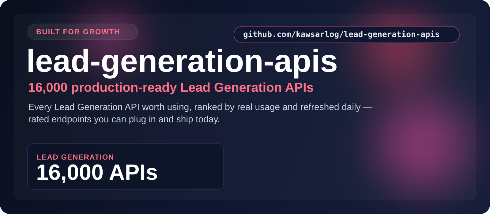

  

  <a href="#at-a-glance"><b>At a Glance</b></a> &nbsp;•&nbsp;
  <a href="#the-categories"><b>Categories</b></a> &nbsp;•&nbsp;
  <a href="#start-here"><b>Start Here</b></a> &nbsp;•&nbsp;
  <a href="#built-for"><b>Built For</b></a> &nbsp;•&nbsp;
  <a href="#why-this-repo"><b>Why This Repo</b></a>

## At a Glance

> **16,000** production-ready Lead Generation APIs.

A focused, always-fresh index of Lead Generation APIs for finding contacts, emails, and buying signals. Every entry is rated, shows real user counts, and is refreshed daily — so you find the right one fast.

| Metric | Value |
|--------|-------|
| **Total APIs** | **16,000** |
| **Categories** | 1 |
| **Last updated** | 2026-10-22 |
| **Update cadence** | Daily, automated |

## The Categories

<table>
  <tr>
    <td width="100%" valign="top">
      <h3>Lead Generation</h3>
      
<strong>16,000 APIs</strong>

      
Find contacts, emails, and buying signals to fuel outbound and enrichment.

      
<a href="./Lead_generation/"><strong>Open Lead Generation &rarr;</strong></a>

    </td>
  </tr>
</table>

## Start Here

1. Pick the category that matches what you're building.
2. Open its folder and scan the API names, ratings, and user counts.
3. Click through to the provider page for docs, pricing, and setup.
4. Shortlist in minutes — no digging through unrelated categories.

## Explore the Stack

<strong>Lead Generation — 16,000 APIs</strong>

Find contacts, emails, and buying signals to fuel outbound and enrichment.

[Browse Lead Generation APIs &rarr;](./Lead_generation/)

## Built For

<table>
  <tr>
    <td width="25%" align="center"><strong>Sales teams</strong></td>
    <td width="25%" align="center"><strong>Outbound tools</strong></td>
    <td width="25%" align="center"><strong>CRM enrichment</strong></td>
    <td width="25%" align="center"><strong>Prospecting</strong></td>
  </tr>
  <tr>
    <td width="25%" align="center"><strong>Email finders</strong></td>
    <td width="25%" align="center"><strong>Growth hacking</strong></td>
    <td width="25%" align="center"><strong>Agencies</strong></td>
    <td width="25%" align="center"><strong>B2B data</strong></td>
  </tr>
</table>

## Why This Repo

- **Opinionated, not exhaustive.** Only the categories that matter here — no clutter.
- **Always fresh.** A scheduled job re-scrapes the source and updates the counts daily.
- **Fast to scan.** Ratings and real usage numbers surface the APIs worth your time.
- **Consistent.** Every category follows the same clean, sortable layout.

---

**16,000 APIs** across **1 categories** — updated 2026-10-22
 If this saved you time, a star helps others find it.

